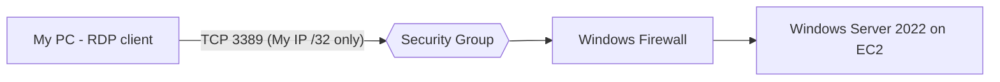

# AWS Windows VM + RDP - Unit 4 Cloud Security Assignment

**PRN:** 2124UCSM1057 | **Class:** 3rd Year | **Department:** Cyber Security

**Topic:** Launch a Windows Server VM on AWS EC2 and connect securely using RDP.

Full report (PDF): [docs/RDP_Windows_VM_Assignment.pdf](docs/RDP_Windows_VM_Assignment.pdf)

## Architecture

## Security Group (rdp-sg)

| Type | Port | Source |
|---|---|---|
| RDP | 3389 | My IP (/32) only - never 0.0.0.0/0 |

## Steps (summary)

1. Launch Windows Server 2022 on `t2.micro` with a new key pair.
2. Allow RDP (3389) only from my IP.
3. Decrypt the Administrator password with the `.pem` key and connect with an RDP client.
4. Explore the desktop and run `systeminfo`, `hostname`, `ipconfig`.
5. Create a low-privilege user with a strong password ([scripts/windows-setup.ps1](scripts/windows-setup.ps1)).
6. Enable Windows Firewall and verify with `Get-NetFirewallProfile`.
7. Create `C:\Lab\hello.txt`.
8. Terminate the instance to avoid charges.

## Security measures

- RDP restricted to a single IP, no other inbound ports
- Separate non-admin user, strong password, account lockout policy
- Windows Firewall enabled on all profiles (defense in depth)
- No passwords stored in the repo or the report

## Screenshots

See [screenshots](screenshots/).
